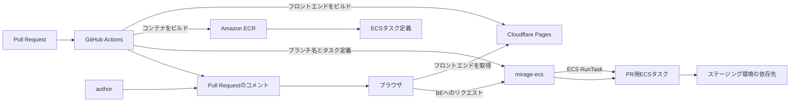
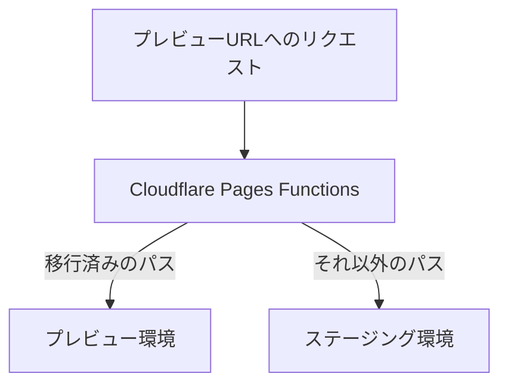

:::message  
この記事は 2026 年 11 月時点の MOSH のプレビュー環境、関連ツールの状況をもとに執筆しています。  
:::

キティサンでミッドナイトシティランしたので初投稿です。

MOSH でソフトウェアエンジニアをしている Yuki Okushi（[@JohnTitor](https://github.com/JohnTitor)）です。

MOSH ではプロダクティビティチームとして、いわゆるプラットフォームエンジニアリング領域の物事を担当しています。  
今回はその中の取り組みの一つであるプレビュー環境について紹介します。

## プレビュー環境構築までの道のり

### プレビュー環境以前

MOSH ではアプリケーションとして現在は両面 TypeScript を推進するモノレポを中心に開発を進めています。  
このアプリケーション向けに共用のステージング環境を用意しており、本番リリース前の最終確認やチーム内での同期的な変更確認のために利用しています。

ただし、共有ステージング環境だけで PR の変更を確認しようとすると、未マージの変更を誰がいつデプロイするかという調整が必要です。  
MOSH では Slack チャンネルで利用と占有時間を宣言して排他的に利用するフローで運用していましたが、たびたび渋滞を起こしてしまうことが課題となっていました。  
Dev Containers を用意するなどローカルでの開発環境も充実させていましたが、エンジニア外への確認などやはりそれだけでは賄えない部分も多く問題の解決には至っていませんでした。

### そしてプレビュー環境誕生へ

この問題を解消するために、プロダクティビティチームでは以下のような特徴を持つプレビュー環境の構築を行いました。

- Pull Request の作成や更新を起点にデプロイできること
- Pull Request のコメントから確認用 URL を開けること
- 同じブランチへの push では固定 URL を使い続けられること
- バックエンドからステージング環境の依存先へ接続できること
- 場合によっては独立した DB に接続できマイグレーションを伴うテスト・動作確認も行えること

以下の項ではこの環境をどのように実現しているかについて紹介していきます。

## プレビュー環境の技術詳細

大枠のフローとしては以下のような感じです（このフローチャートは AI ちゃんに作ってもらいました）：



### フロントエンド: Cloudflare Pages

フロントエンドは Pull Request のブランチごとにビルドし、Cloudflare Pages へデプロイしています。  
このデプロイ時にバックエンドへの向き先をプレビュー環境に向けるよう環境変数を注入しています。

Cloudflare Pages にはデプロイごとの URL とブランチ名の URL が存在しており、これらをそのままプレビュー環境のフロントエンド URL として利用しています。

https://developers.cloudflare.com/pages/configuration/preview-deployments/

### バックエンド: mirage-ecs

バックエンドの起動とリクエストの中継には[mirage-ecs](https://github.com/acidlemon/mirage-ecs)を利用しています。  
mirage-ecs は、指定されたサブドメインと ECS タスク定義をもとにタスクを起動し、そのサブドメインへの HTTP リクエストを対象タスクへプロキシします。

GitHub Actions を介してアプリケーションの image を Amazon ECR へ push した後、`ecspresso register`で ECS タスク定義を登録しています。  
OAuth のコールバック URL など、ブランチごとに変わる値も mirage-ecs の`parameters`を通して ECS タスクの環境変数へ渡しています。

```json
{
  "subdomain": "feature-example",
  "taskdef": ["<task-definition-arn>"],
  "branch": "feature/example",
  "parameters": {
    "oauth_redirect_uri": "https://feature-example.preview.example.com/callback"
  }
}
```

この構成では、Pull Request ごとに ECS Service、ALB の Target Group、Listener Rule を作る必要がありません。  
共有の mirage-ecs がリバースプロキシとなり、Pull Request ごとの差分は ECS タスクとして起動します。  
ECS タスクはステージング環境と同じ VPC 内で動くため、プライベートネットワーク内の依存先にもステージング向けとして既にある接続方式を利用できるのが嬉しみポイントです。

mirage-ecs の仕組みと構築方法は、作者さんの次の記事にも詳しくまとまっています。

https://zenn.dev/fujiwara/articles/fujiwara-ware-2024-mirage-ecs

ただし、mirage-ecs を採用できるかどうかはサービス間通信の方式にも左右されます。  
たとえば estie さんでは、ECS Service Connect を利用する要件から mirage-ecs を採用せず、通常の ECS Service を作る方式を選んでいるとのことです。  
この辺りはアプリケーション・インフラ構成によるので、皆さんの環境に合わせて採用する必要があります。

https://www.estie.jp/blog/entry/2024/10/03/170000

## プレビュー環境の背景やこだわりポイント

### バックエンドを Cloudflare Workers から ECS へ移した理由

実は MOSH のバックエンドプレビュー環境は、最初から ECS で動いていたわけではありません。  
以前は Cloudflare Workers へバックエンドをデプロイし、Pull Request ごとにサーバーレス PostgreSQL の[Neon](https://neon.com/)でデータベースを作成していました。  
スモールスタートとして GitHub Actions だけでさくっと作れる部分が利便性高く、これはこれでメリットもある構成でした。

しかし、バックエンドの本番とステージングの実行基盤は Bun と ECS であり、Cloudflare Workers へデプロイするには、一部のパッケージをプレビュー環境に合わせて切り替える必要があります。実際 Datadog のトレーシングを Workers 向けに調整する必要があるなど、プレビュー向けにちょっと手を加える必要がある、i.e. 実環境と完全に同じ状態にできないという話がありました。  
加えて、Workers からステージング環境のプライベートな依存先へ接続できないため、プレビューできる機能の範囲が狭まってしまうという問題もありました。

こういった本番とは異なるランタイムを維持する作業が増え、かつプレビュー環境と本番環境の動作の差異が目立ってきたため、フロントエンドは Cloudflare Pages に残し、バックエンドだけを Bun と ECS（i.e. 本番環境と同じインフラ環境）へ移しました。

### 移行途中の画面も同じ URL で確認できるようにする

MOSH のフロントエンドは、旧来のアプリケーションから前述のモノレポへ段階的に移行しています。  
そのため、モノレポのビルドだけですべてのパスを配信することはできません。

これに対応するため Cloudflare Pages Functions で移行に合わせたルーティングを行なっています。  
移行済みのパスはプレビュー環境へ渡し、それ以外のパスはステージング環境へプロキシします。  
これにより同じ URL のまま移行状況を意識することなくプレビュー環境を利用できるようにしています。



https://developers.cloudflare.com/pages/functions/

### PR ごとに分離する isolated DB

通常のプレビュー環境では、バックエンドはステージングの DB を共有しています。  
ただ、テーブルやカラムの追加・変更を含む PR では、それらを適用した DB をもって動作確認を行いたいケースも多々あるかと思います。  
そこで、必要な PR に`isolated-db`ラベルを付けることで、専用の DB を利用できるようにしています。

専用 DB は、ステージングの Aurora PostgreSQL クラスタ内にプレビューごとの DB を作成して用意しています。  
Aurora クラスタの計算資源や他サービスは引き続きステージング環境と共有しつつ、バックエンドが接続する DB のテーブル定義とデータだけ分離させる方針を採っています。

ラベルの付与をトリガーに、GitHub Actions から DB の初期化・作成、PR のマイグレーションの適用、開発用シードデータの投入、アプリケーション用の権限設定を行うようにしています。また push 後も検証用に作ったデータを保持できるよう、再デプロイ時はその PR の DB にマイグレーションのみ適用することでこれを実現しています。

便利ポイントとして、関連する PR 間で同じ DB を使うための方法も用意しています。  
たとえば別の PR に`isolated-db:1234`ラベルを付ければ、PR #1234 が作成した DB に接続できます。stacked PR などで一つの機能を継続的に開発していくときなどに有用です。

### 使われない ECS タスクを残さない

プレビュー環境は便利な一方で大量に作られやすいという問題もあります（昨今は特に）。そのため、あるタイミングで都度消していくワークフローを整えることも重要です。

MOSH では、Pull Request が閉じられたときをトリガーとして環境の削除を行うようにしています。  
これに加えて、mirage-ecs の purge 機能を使い一定期間リクエストがない ECS タスクを定期的に停止するようにもしています。  
先に紹介した専用 DB も似たようなタイミングでクリーンアップしています。

プレビュー環境の利用者は ECS タスクのライフタイムを特に意識せず使えるので QoL 的にもコスト的にも嬉しい部分です。

### spot instance の採用

プレビュー環境では spot instance を利用しています。

MOSH では常時 100 以上のプレビュー環境が動いており、これを通常インスタンスで動かすとコストがとんでもないことになります。  
プレビュー環境は常時利用される環境ではないため、spot instance 化することでコストの低減につなげています。

ただし昨今ではコンピューティングリソースが不足してきているという話もあり、今後 spot instance が利用不可になる時間も増えていくかもしれません。この辺りは状況見つつ判断していく必要があるなと思っています。

## まとめ

以上、MOSH のプレビュー環境を紹介しました。

このプレビュー環境によって冒頭のステージング問題は無事解消されており、AI 時代の開発速度にも適応できています。

また、Cloudflare Workers から ECS への移行や isolated DB の導入などはプレビュー環境へのフィードバックから生まれたものです。  
プラットフォームエンジニアリングのような取り組み全般に言えるものですが、こういう環境は作って終わりではなくフィードバックを拾って改善していく活動も肝要です。  
これからもより便利なものにできたらなあという思いです。
